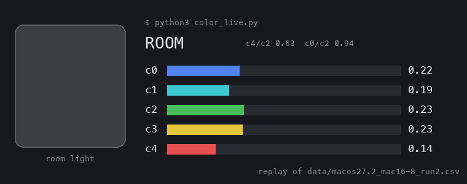
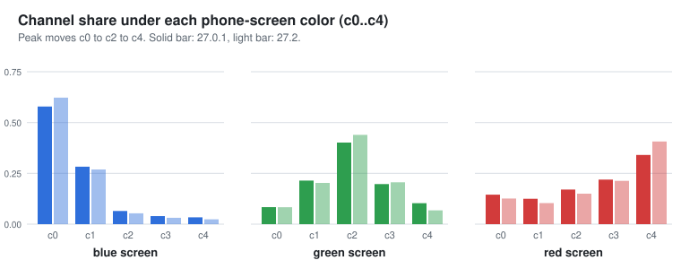
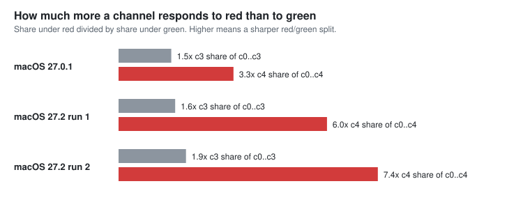

# Reading the five raw channels of the MacBook light sensor on macOS

The Apple Silicon MacBook ambient light sensor (`als`) reports more than lux. Its
HID report on macOS carries five channels, c0..c4, plus lux and a color
temperature. This repository reads them with a standard-library Python script,
shows live what the sensor sees, and measures how the channels respond to
colored light. The public macOS tools I found (as of 2026-11-03) read at most
four of the channels; the fifth, c4, separates red from green best in my
measurements. Much of the layout was public before this (see Prior work); what
is new here is narrower and listed there.



*`color_live.py`'s display, replayed from the recorded run
`data/macos27.2_mac16-8_run2.csv` (not a live screen capture; drawn by
`tools/make_demo_gif.py`, which needs Pillow).*


## Quick start

```
# Python 3.8+, Apple Silicon MacBook
python3 color_live.py                  # live channel bars and a color guess
python3 als_probe.py out.csv --wait    # step-by-step color test, saved to CSV
python3 analyze.py out.csv             # per-step medians and channel ratios
```

The sensor is at the top center of the display, next to the webcam. Put solid
red, green, blue and white images on your phone (or AirDrop `docs/colors.html`
to it and tap to switch colors), turn its brightness to maximum and switch off auto-brightness, Night Shift
and True Tone. Hold the screen flat against the sensor. If the scripts cannot open the
sensor, give your terminal Input Monitoring permission (System Settings, Privacy
and Security) or run them with `sudo`.

`color_live.py` measures room light for 3 s, then redraws five channel bars and
a guess (RED, GREEN, BLUE, WHITE, COVERED or ROOM) about five times a second.
The guess uses channel-ratio thresholds with wide margins chosen on the three
runs here (phone OLED screens, one machine); it is a rule of thumb, not a
calibrated color measurement.

`als_probe.py` runs eight steps (baseline, cover, red, green, blue, white,
flashlight, baseline). At each color step hold that screen against the sensor.
At the cover step cover the sensor fully with a fingertip; at the flashlight
step shine the phone's LED at it from about 10 cm.

<details>
<summary>More on the scripts</summary>

- Without `--wait`, all eight steps run back to back on a timer (about 45 s,
  5 to 6 s each), so have the screens ready. With `--wait`, each step waits for
  Enter, then counts down 3 s (reports in that window and while waiting are
  dropped, so moving the phone into place is not recorded), then records 10 s.
  In both modes Ctrl-C saves the rows collected so far.
- Output `out.csv` columns: `t, phase, c0..c4, lux, hex`.
- Permissions: opening the HID device may require Input Monitoring for your
  terminal (System Settings, Privacy and Security, Input Monitoring), or `sudo`.
  If it cannot open, the script prints an error and exits.
- On a model other than Mac16,8 the scripts print a note that the decode is
  unverified there, then decode anyway. Check the values look sensible.
- Channels are decoded only for the 122-byte report. On any other length
  `als_probe.py` prints a warning and logs raw hex only.
- `analyze.py` prints, for each step, the median of the second half of its
  samples and each channel's share of c0..c4 (the method behind the tables
  here). `--subtract-cover` subtracts the cover step from the channels first and
  prints the signed differences; the ratio uses the positive part only and lux
  is not subtracted. A finger over the sensor is not a true dark reference (it
  passes some red), so read that mode with care.

</details>

## Prior work

Most of this was public before I started; what is new here is
narrower:

- On macOS, [olvvier/apple-silicon-accelerometer](https://github.com/olvvier/apple-silicon-accelerometer/blob/d140bda54ff915a97f1015188a0c43247c187079/motion_live.py#L672-L694)
  has read this same 122-byte HID report since 2026-02-21: lux at byte 40 and
  four unlabeled channels at bytes 20..32, drawn as live bars.
  [SaintD1smas/TrueTone](https://github.com/SaintD1smas/TrueTone/blob/4bf513544163c230483ace6c40bd88e4760f3993/Sources/TrueTone/AmbientSensor.swift)
  (public since 2026-09) reads the color temperature and four channels through
  the HID event API.
- For Linux, the Asahi [`aop_als`](https://github.com/AsahiLinux/linux/blob/414812147991cf1ced35a7345782ea4eef4e73bb/drivers/iio/common/aop_sensors/aop_als.rs) driver has used the lux offset (0x28,
  byte 40) for the VD6286 since 2024-11. [triutama133/ubuntu_asahi_patch](https://github.com/triutama133/ubuntu_asahi_patch/blob/3cb6569aaa56815e86b487111725a4d05406bd00/kernel-patches/README.md)
  described all five channels (0x14..0x24, bytes 20..39) on 2026-08-28 and
  identified the chip as an ST VD6286. Its first version labeled them in the
  opposite order (red at 0x14 to violet at 0x24); a revision on 2026-08-30
  relabeled them blue, clear, green, red and IR from its own colored-light
  tests and added the color temperature (0x45, byte 69).

The Linux write-up's offsets match mine. What this repository adds: c4 on macOS (the macOS tools
above read four channels), published raw data with per-channel color responses,
a comparison with the Linux channel labels (one does not fit these measurements
and one is only partly supported), the remaining bytes of the report beyond the
channels, lux and color temperature, and a live color guess.

Measured on one MacBook Pro Mac16,8 (M4 Pro): one run on macOS 27.0.1, two on
27.2 (26B123). The driver is named `AppleSPUVD6286`; not confirmed from a
datasheet. The M4 generation is not supported by Asahi Linux, so none of this
was measured under Linux. I opened a pull request upstream to read c4
([olvvier/apple-silicon-accelerometer#25](https://github.com/olvvier/apple-silicon-accelerometer/pull/25)).

## What the als report contains (122-byte report)

```python
import struct
channels = struct.unpack_from("<5I", report, 20)   # c0..c4
lux      = struct.unpack_from("<f",  report, 40)[0]
cct      = struct.unpack_from("<f",  report, 69)[0]   # likely color temperature, K
```

`MaxInputReportSize` for the `als` node is 122 (from `ioreg`). Every byte,
checked across all 1074 recorded reports (`als_decode.decode_fields`):

| Offset | Type | Meaning | Confidence | Evidence |
|---|---|---|---|---|
| 0 | u8 | report ID, 0xEC | confirmed | constant |
| 1..4 | u32 | sequence counter | confirmed | +1 per report (a few gaps when the run loop was paused) |
| 5..12 | u64 | timestamp in microseconds, likely since boot | confirmed | rises 0.99996 to 1.00008 x 10^6 per second of host time |
| 13..19 | | zero | confirmed | always 0 |
| 20..39 | u32 x5 | channels c0..c4 | confirmed | color tests below |
| 40..43 | f32 | lux | confirmed | tracks brightness |
| 44..62 | | zero | confirmed | always 0 |
| 63..66 | u32 | constant 19 | unknown | same in all runs |
| 67 | u8 | mode or gain flag | likely | 0x40; switched to 0x20 under the phone LED at c3 about 169k and stayed there for the rest of that run, with channels and lux continuous across it |
| 68 | u8 | zero | likely padding | always 0 |
| 69..72 | f32 | color temperature, K | likely | room about 5000, white screen 6000 to 8100, blue screen 12800 to 14100, phone LED about 4500; meaningless for saturated red or green |
| 73..80 | u32 x2 | two equal constants | unknown | 97300 on macOS 27.0.1, 197380 on 27.2 |
| 81..121 | | zero | confirmed | always 0 |

The same color temperature offset (0x45) appears in the prior work above. The
driver's type encoding does not map onto this byte layout directly (see the
cross-check below), so the HID report looks like its own packed format.

## Channel response follows wavelength order (color test)

I lit the sensor with solid colors from a phone screen and took, for each step,
the median of the second half of its samples, as a share of c0..c4:



- The peak channel moves c0 (blue) to c2 (green) to c4 (red), consistent with
  c0..c4 running in wavelength order. Under green, the neighboring channels c1
  and c3 rise together. The placement of c1 and c3 is inferred from this
  neighbor response only; three phone primaries cannot pin down all five.
- Across the three runs the peak channel is the same for the blue, green and
  red screens (white is broad). The blue
  and green rows agree within 0.06 per channel; the red row varies more (c4
  share 0.34 to 0.47), tracking how dark the cover step was.
- Red was the weakest leg in the first two runs, because the finger did not
  fully cover the sensor: with it "covered", lux was still about 158 (27.0.1)
  and 39 (27.2 run 1), and red c4 was only 3.2x and 2.1x the covered level. In
  27.2 run 2 the sensor was covered properly (lux about 19), each step got a 3 s
  settle before 10 s of recording, and red c4 was 2434 against 198 covered,
  12.3x. A phone OLED red is still not a narrow line.

<details>
<summary>Tables</summary>

macOS 27.0.1:

| screen color | peak channel | c0 | c1 | c2 | c3 | c4 |
|---|---|---|---|---|---|---|
| blue  | **c0** | 0.58 | 0.28 | 0.06 | 0.04 | 0.03 |
| green | **c2** | 0.08 | 0.21 | 0.40 | 0.20 | 0.10 |
| red   | **c4** | 0.15 | 0.12 | 0.17 | 0.22 | 0.34 |
| white | broad  | 0.24 | 0.22 | 0.25 | 0.14 | 0.15 |

macOS 27.2 (26B123) run 1, all 217 reports 122 bytes:

| screen color | peak channel | c0 | c1 | c2 | c3 | c4 |
|---|---|---|---|---|---|---|
| blue  | **c0** | 0.62 | 0.27 | 0.05 | 0.03 | 0.02 |
| green | **c2** | 0.08 | 0.20 | 0.44 | 0.21 | 0.07 |
| red   | **c4** | 0.13 | 0.10 | 0.15 | 0.21 | 0.41 |
| white | c0, broad | 0.31 | 0.21 | 0.24 | 0.13 | 0.10 |

macOS 27.2 (26B123) run 2, all 403 reports 122 bytes:

| screen color | peak channel | c0 | c1 | c2 | c3 | c4 |
|---|---|---|---|---|---|---|
| blue  | **c0** | 0.64 | 0.27 | 0.05 | 0.03 | 0.02 |
| green | **c2** | 0.10 | 0.21 | 0.43 | 0.20 | 0.06 |
| red   | **c4** | 0.10 | 0.08 | 0.13 | 0.22 | 0.47 |
| white | c0, broad | 0.34 | 0.22 | 0.23 | 0.12 | 0.08 |

With the cover step subtracted, the 27.2 run 1 red row becomes c3 86 and c4 376 with
c0..c2 slightly below the cover level, so the red signal there is only a few
hundred counts.

</details>

## Why the fifth channel matters



With only c0..c3, the most red-sensitive channel is c3. Its share under a red
screen is not far from its share under a green one. Adding c4 widens that gap
several times over (phone OLED screens, no cover subtraction):

| run | c3 share of c0..c3, red / green | c4 share of c0..c4, red / green |
|---|---|---|
| 27.0.1 | 0.33 / 0.22 (1.5x) | 0.34 / 0.10 (3.3x) |
| 27.2 run 1 | 0.36 / 0.22 (1.6x) | 0.41 / 0.07 (6.0x) |
| 27.2 run 2 | 0.41 / 0.21 (1.9x) | 0.47 / 0.06 (7.4x) |

(Multipliers use unrounded shares.) The c3 share is a simple 4-channel metric,
not the best one: c3/c2 alone already rises from about 0.5 under green to 1.3
to 1.7 under red, so four channels can tell red from green. Adding c4 still
widens the contrast (c4/c2: about 0.14 to 0.26 under green, 2.0 to 3.6 under
red), and of the five channels c4 has the largest red/green contrast in all
three runs.

So the channel those tools do not read is the one that best separates red from
green. This is three runs with phone primaries, not a calibrated spectral
measurement.

## Channel labels: comparison with the prior work

The Linux write-up labels c0..c4 blue, clear, green, red and IR, from its own
colored-light tests. On this machine with phone-screen light, one label does not
fit and one is only partly supported (27.2 run 2 shares):

- **c1 as "clear" (broadband)**: a clear photodiode should respond to every
  color. Relative to the strongest channel, c1 is 0.42 of c0 under blue and
  0.48 of c2 under green, but only 0.18 of c4 under red, the smallest share of
  all five there (0.08). It behaves like a blue-green channel.
- **c4 as "IR" and c3 as "red"**: under a red screen c4, not c3, has the largest
  share (0.47 against 0.22). A phone OLED red emits little infrared, and under
  the phone's white LED (also little infrared) c4 responds about as much as the
  other channels (0.17), so c4 is not an infrared-only channel. A red long-pass
  channel that also reaches into the near infrared would fit both readings; a
  finger over the sensor (c4 0.29) passes both, so it cannot tell. An IR source
  such as a TV remote would settle it.

Labels here stay neutral (c0..c4) for that reason.

## What existing public tools read

The macOS tools I checked (as of 2026-11-03) read at most four channels. Two
parse the 122-byte report directly; the Swift one started as a port of the
Python one, so they are one design, not two independent findings. Both read
only the first four channels, which the Python package's README documents as
"lux + 4 spectral channels". SaintD1smas/TrueTone (see Prior work) reads four
channels through the HID event API instead.

- **olvvier/apple-silicon-accelerometer** (Python; the package is named
  `macimu`): [`macimu/__init__.py`](https://github.com/olvvier/apple-silicon-accelerometer/blob/203685640287449eaecf521c24d1f5e52486ecb7/macimu/__init__.py) uses channel offsets `[20, 24, 28, 32]`, i.e.
  four channels, not offset 36.
- **junwatu/macimu** (Swift): [`IMU.swift`](https://github.com/junwatu/macimu/blob/b8b4ebbaae54279bd3f3a5d9aef5b852f048cd4a/Sources/MacIMU/IMU.swift) reads offsets 20/24/28/32, the same four.

So on this layout the fifth channel (offset 36) is present in the report but not
read. I opened a pull request to add it:
**[olvvier/apple-silicon-accelerometer#25](https://github.com/olvvier/apple-silicon-accelerometer/pull/25)** ("read_als: include the 5th spectral
channel at offset 36").

## Cross-check: the driver struct has five-wide arrays

<details>
<summary>Driver type encoding (a weak cross-check)</summary>

Because "five channels" is my reading of the bytes, I cross-checked it against
Apple's driver symbols. The `com.apple.driver.AppleALSColorSensor` kext carries
an Objective-C type encoding for its als report, and the VD6286 vendor-data
member is (source: the [blacktop/ipsw-diffs kext diff for macOS 27.0 betas
26A5378n vs 26A5388g](https://github.com/blacktop/ipsw-diffs/blob/ee7c537d56250c6157860d81cb27273fcb30aaa8/macOS/27_0_26A5378n_vs_27_0_26A5388g/KEXTS/com.apple.driver.AppleALSColorSensor.md)):

```
alsdefines_vendorvd6286_s = I [5i][5i][5s] f I f I I f I [5I]
```

The `[5i]` and `[5I]` arrays are five wide, consistent with five channels.
I did not establish which of those arrays the bytes 20..39 correspond to, only
that a five-channel block is what the driver describes and what I measured.
The same encoding also lists other vendor variants (for example a
`vendormorayfamily_s` with `[5f]` float arrays); which one a given machine uses
is not shown by the encoding. Five-wide arrays are not unique to VD6286 either
(`vendorct725_s` has `[5i][5s]`), so this is a weak cross-check.

</details>

## Honest limits

- No absolute calibration of lux or the channels (relative ratios only).
- Channel center wavelengths are not confirmed against a datasheet; only the
  blue to green to red peak order is established by measurement. Whether c4 also
  covers near-infrared (as the prior work labels it) is not tested.
- "Five channels" is what this report and the driver struct expose. I did not
  confirm the VD6286 channel count against a datasheet; the related VD6283 is
  documented as a 6-channel color sensor, so another channel elsewhere is not
  ruled out.
- The recorded hex includes the sensor timestamp, which reveals the machine's
  uptime at the time of each run (about 14 and 5 days). Nothing else in it looks
  machine-specific, but that was not compared against another Mac.
- Single machine (Mac16,8), three runs (one on 27.0.1, two on 27.2), phone OLED
  as the only colored light source. The 122-byte layout was verified on 27.0.1 and 27.2.

## Reproduce

Standard library only (`ctypes` + IOKit), no external dependencies.

All three runs behind the tables and figures are in `data/` (same columns as
`als_probe.py` output, raw report hex included):

- `data/macos27.0.1_mac16-8.csv`: eight steps including flashlight. The step
  labels were in Korean and have been translated to English; nothing else was
  changed.
- `data/macos27.2_mac16-8.csv`: taken with an earlier version of the script,
  seven steps (no flashlight) with labels such as `RED` and `cover sensor`.
- `data/macos27.2_mac16-8_run2.csv`: current script with `--wait` (3 s settle,
  10 s per step), sensor well covered (lux about 19 in the cover step).

```
python3 analyze.py data/macos27.0.1_mac16-8.csv
python3 analyze.py data/macos27.2_mac16-8.csv
python3 analyze.py data/macos27.0.1_mac16-8.csv --subtract-cover
python3 make_figures.py                  # redraws docs/*.svg
python3 -m unittest -v test_decode       # checks decode and the README numbers
```

Results from other Mac models are welcome as issues (there is a template): include
the model (`sysctl -n hw.model`), the macOS version, and the `analyze.py` output.
An IR test (a TV remote held at the sensor while `color_live.py` runs) would
settle the c4 question.

## License

MIT. See `LICENSE`.

## Author

Byungkun Jang
